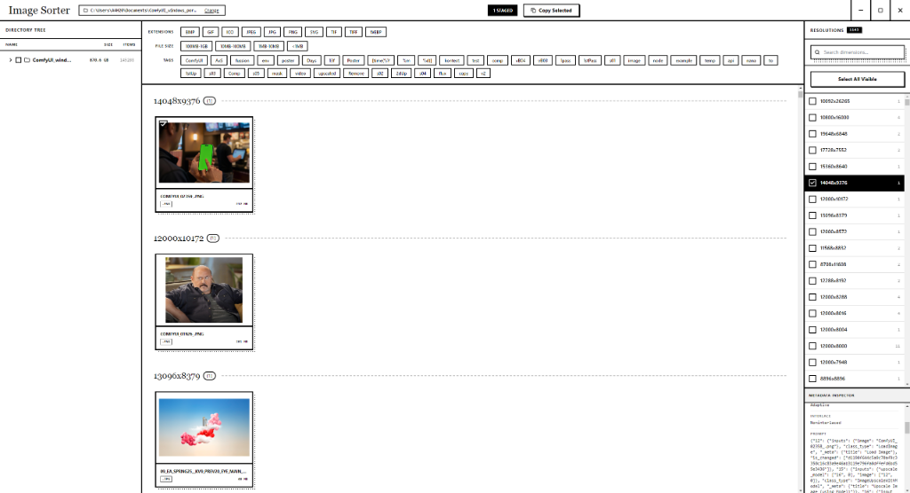

# Image Sorter



A desktop application for managing and sorting large directories of images.

## How it works

1. **Select Folder**: Open the application and choose a folder on your computer to scan.
2. **Filter Images**: Use the filters to find exactly what you need based on:
   - File extensions (`.jpg`, `.png`, `.webp`, etc.)
   - File size (`< 1MB`, `1-5MB`, etc.)
   - Auto-extracted tags from filenames
   - Exact pixel dimensions (e.g., `1920x1080` or `3840x2160`)
3. **Copy Selected**: Select individual images or entire resolution groups, then click "Copy Selected" to copy them to a new destination folder.

## Features

- **Metadata Inspector**: Select any single image to view its embedded EXIF, IPTC, and XMP data in the right panel.
- **Directory Tree**: Easily navigate through subfolders within your selected directory.

## Installation

### For Windows Users
1. Go to the [Releases](../../releases) page.
2. Download `Image Sorter <version>.exe`.
3. Run the executable. No installation required.

### Building from Source

**Requirements:**
- Node.js (v18+)
- npm

```bash
# Clone the repository
git clone https://github.com/VantageInc/image-sorter.git
cd image-sorter

# Install dependencies
npm install

# Run locally
npm run dev

# Build Windows executable
npm run build

# Build macOS app (must be run on macOS)
npm run build:mac
```
