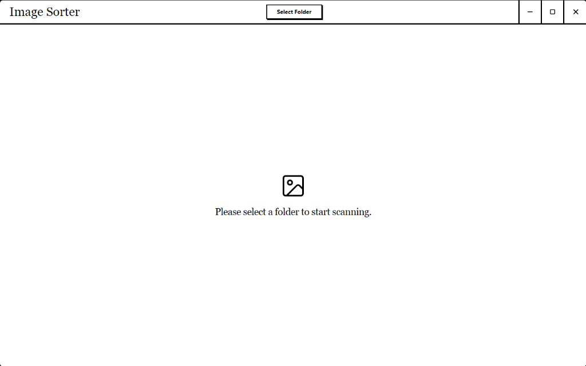

# 🖼️ Image Sorter



A lightning-fast, brutally minimalist desktop application for managing and sorting large directories of images. Built with Electron, React, and Vite.

## Features

- **🚀 Native Performance**: Generates OS-level image thumbnails (`nativeImage.createThumbnailFromPath`) asynchronously. Hundreds of images load instantly without memory leaks or UI freezes via `IntersectionObserver` lazy-loading.
- **🖤 Brutalist Aesthetic**: A high-contrast, sharp-cornered UI inspired by modern brutalism. Every interaction is tactile and immediate. Custom frameless window controls.
- **📂 Deep Filtering**: 
  - Dynamic extensions filter (`.png`, `.jpg`, `.psd`, `.webp`, etc.)
  - Range-based size buckets (`< 1MB`, `1-5MB`, `> 10MB`)
  - Auto-extracted semantic Tags based on filenames.
- **📐 Resolution Grouping**: Images are automatically categorized and grouped by their exact pixel dimensions (e.g., `1920x1080`). Easily bulk-select entire resolution buckets.
- **🔎 Metadata Inspector**: Select any image to instantly view its embedded EXIF, IPTC, and XMP data via a fast binary chunk-reader (`exifr`).

## Installation

### For Windows Users (Portable)
1. Go to the [Releases](../../releases) page (if published).
2. Download `Image Sorter <version>.exe`.
3. Run the executable. No installation required.

### Building from Source

**Requirements:**
- Node.js (v18+)
- npm or yarn

```bash
# Clone the repository
git clone https://github.com/yourusername/image-sorter.git
cd image-sorter

# Install dependencies
npm install

# Run in development mode
npm run dev
```

### Packaging for Production

To create a portable executable for Windows:
```bash
npm run build
```
*(The output will be in the `release/` folder).*

To create a build for macOS (Must be run on a macOS machine):
```bash
npm run build:mac
```

## Tech Stack
- **Framework**: Electron + Vite
- **Frontend**: React + Tailwind CSS
- **Icons**: Lucide React
- **Metadata Handling**: `exifr` and `image-size`
- **Builder**: `electron-builder`
