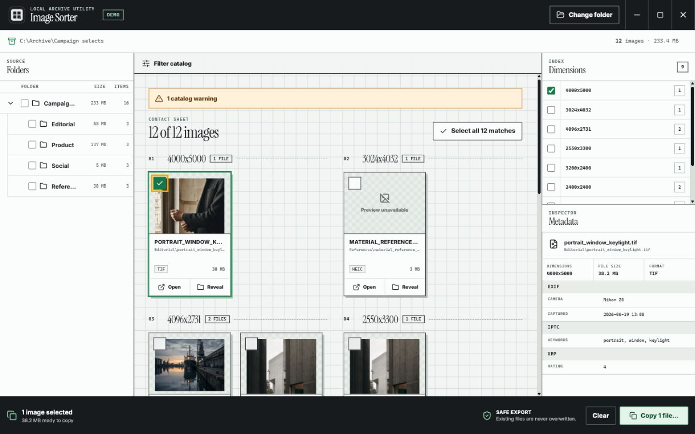

# Image Sorter



Image Sorter is a private, offline desktop contact sheet for large image folders. Scan once, narrow the catalog by folder, format, size, filename tag, or exact pixel dimensions, then export a reviewed selection without overwriting existing files.

## Why it is safe to use

- All scanning, metadata reading, thumbnails, and copying happen on your computer.
- The renderer is sandboxed and receives only a small validated desktop API.
- Exports preserve paths relative to the selected source folder.
- Existing destination files are never overwritten; conflicts receive a numbered filename.
- One scan builds both the image catalog and folder tree, with progress, cancellation, and recoverable warnings.

## Downloads

Open the [latest GitHub release](https://github.com/VantageInc/image-sorter/releases/latest) and choose:

- `Image-Sorter-1.1.0-Windows-x64-Setup.exe` for a normal Windows 10/11 installation.
- `Image-Sorter-1.1.0-Windows-x64-Portable.exe` for a portable Windows 10/11 build.
- `Image-Sorter-1.1.0-macOS-x64.dmg` for Intel Macs running macOS 12 or newer.
- `Image-Sorter-1.1.0-macOS-arm64.dmg` for Apple silicon Macs running macOS 12 or newer.

ZIP archives are also provided for both macOS architectures. Every release
includes `SHA256SUMS.txt` and GitHub build-provenance attestations.

### Verify a download

On Windows PowerShell, place the downloaded executable beside
`SHA256SUMS.txt`, update `$file` if needed, and run:

```powershell
$file = ".\Image-Sorter-1.1.0-Windows-x64-Setup.exe"
$name = [IO.Path]::GetFileName($file)
$expected = (Get-Content .\SHA256SUMS.txt | Where-Object { $_.EndsWith("  $name") }).Split()[0]
$actual = (Get-FileHash -Algorithm SHA256 $file).Hash.ToLowerInvariant()
if ($actual -ne $expected) { throw "SHA-256 checksum mismatch" }
"Verified $name"
```

On macOS, place the download beside `SHA256SUMS.txt`, change the filename for
Intel if needed, and run:

```bash
file="Image-Sorter-1.1.0-macOS-arm64.dmg"
grep "  $file$" SHA256SUMS.txt | shasum -a 256 -c -
```

If you use the GitHub CLI, you can additionally verify that a file was produced
by this repository's release workflow:

```bash
gh attestation verify "$file" --repo VantageInc/image-sorter
```

The current community binaries are not code-signed or notarized. After
verification, Windows may require **More info → Run anyway** in SmartScreen.
On macOS, drag the app into Applications and try to open it once, then follow
[Apple's current instructions](https://support.apple.com/102445): open
**System Settings → Privacy & Security** and choose **Open Anyway** for Image
Sorter. Confirm only after verifying the checksum; the override is available
for a limited time after the blocked launch. Do not disable SmartScreen or
Gatekeeper globally.

## Core workflow

1. Choose a source folder.
2. Follow scan progress or cancel a long scan.
3. Filter the catalog and review exact resolution groups.
4. Select individual images, a resolution group, or all currently shown images.
5. Review the selected count and byte size in the export tray.
6. Choose a destination and copy. Image Sorter reports copied, renamed, and failed files without blocking the interface.

Common raster formats are inspected directly. Complex design, RAW, EPS, AI, and PDF files use safe embedded previews or operating-system thumbnails when available; an unavailable preview never prevents cataloging or copying the source file.

To keep untrusted or unexpectedly large directory trees responsive, a scan is
bounded to 50,000 directories, 500,000 filesystem entries, and 50,000 supported
images. Image Sorter keeps the partial catalog usable and reports a warning when
a boundary is reached. Metadata and preview reads have separate byte and pixel
budgets.

## Development

Requirements:

- Node.js 22.12 or newer
- npm 10.9 or newer
- Windows 10/11 or macOS 12+ for desktop verification

```bash
git clone https://github.com/VantageInc/image-sorter.git
cd image-sorter
npm ci
npm run dev
```

Useful checks:

```bash
npm run check
npm run build:app
npm run dist:win
npm run dist:mac:x64
npm run dist:mac:arm64
```

Build macOS packages on macOS. Tagged releases are built on native Windows, Intel macOS, and Apple silicon macOS GitHub runners.
The release workflow first creates a draft, so all packages, checksums, and
attestations can be verified before the release becomes public.

## Project policy

- [Contributing](CONTRIBUTING.md)
- [Security policy](SECURITY.md)
- [Changelog](CHANGELOG.md)
- [Third-party notices](THIRD_PARTY_NOTICES.md)
- [MIT license](LICENSE)
